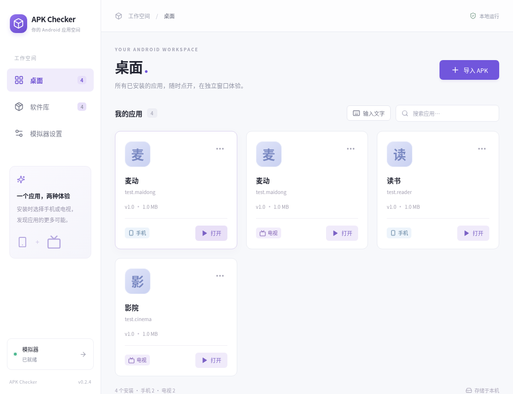

# 0.2.4 安装设备选择与统一桌面

软件库点击“安装”后选择手机或电视，再确认安装。已安装的设备标记为“已安装”，可继续安装到另一设备；桌面统一展示所有实际安装卡片，分别标注设备类型。同一 APK 双设备安装时桌面显示两张卡片，软件库仍一份文件。

卡片打开和卸载绑定自身设备，卸载确认会捕获目标，刷新或默认设置变更不会切换目标。安装状态只认当前 AVD 的匹配记录；软件库“已安装”筛选表示任意当前设备已安装。许可确认、下载准备及后续安装均使用用户选择的目标，不迁移或清空已有数据。

顶部不再显示模式 Tab。电脑文字入口只有一个设备运行时直接指向它，两种设备同时运行时明确选择目标；进入文字弹窗后目标保持固定。默认设置改为“默认安装设备”。Android 引擎、APK 解析、安装接口及文字传输没有修改。

## 实际浏览器交互检查

使用 Chromium + Python Playwright 的 API fixture，执行 [verify-install-ui.py](../../scripts/verify-install-ui.py) 八组检查：

- 无模式 Tab，旧 AVD 记录不作为当前安装；两种设备的应用同时显示。
- 软件库跨设备安装状态筛选及搜索。
- 安装目标选择／取消，忙态防重复，安装成功前不显示桌面卡片。
- 同一 APK 双设备安装、各自标签及打开目标；软件库保留单卡片。
- 卸载目标在状态刷新后保持，卸载后另一设备卡片仍存在。
- 安装失败显示错误，不新增桌面卡片。
- 许可取消不执行安装，同意后只准备和安装选定设备。
- 取消环境准备阻止后续安装，保留另一设备已有安装。

另执行 [verify-text-input-ui.py](../../scripts/verify-text-input-ui.py) 八组检查，覆盖完整文字输入、IME 确认、忙态／重复保护、模式选择和固定目标、关闭设备提示及键盘焦点。设备选择框打开时若选中设备下线，不会自动切换目标；确认按钮禁用，键盘可到达仍可用设备并显式选择。页面错误为 0。实际查看 1040 像素截图，1040／900／800 像素宽度无横向溢出。

下图为浏览器 fixture，应用名称及安装状态为测试数据，**不是 Android 安装或目标 Mac 使用证明**。

## 复现与边界

先启动 `npm run dev:web`，再运行 `python3 scripts/verify-install-ui.py` 和 `python3 scripts/verify-text-input-ui.py`。测试主机需要 Python Playwright 与 Chromium，可通过 `APK_UI_URL`、`APK_CHROMIUM_PATH` 指定地址和浏览器；这些不是产品运行依赖。接口 fixture 验证界面动作及参数，不宣称真实 Android 安装成功。

本轮 216 项已有回归测试通过，TypeScript 与生产构建通过。0.2.3 的 Android 文字输入／安全弹窗证据仍对应旧生产提交；本轮只改设备选择和列表呈现，不扩大这些实际平台结论。0.2.4 安装包验收单独追加。

## 原生安装包检查

源提交 [8c1bcac](https://github.com/ecojust/apk-checker/commit/8c1bcac)，[构建 run 42133367618](https://github.com/ecojust/apk-checker/actions/runs/42133367618)。第一轮 ARM、Windows job 全部通过；Intel 测试、构建、便携工具、DMG 挂载／签名／实际客户端启动、校验和全部通过，仅上传安装包时 GitHub CreateArtifact 服务连续 5 次超时，整体保留 failure。只重试 Intel 以恢复产物上传，不修改客户端或覆盖前两个平台结果。

第一轮原生日志确认 ARM／Intel 各 216 项通过，Windows 214 项通过、2 项平台跳过。两种 Mac 均确认 `dmgIntegrityVerified`、`mountedBundleSignatureVerified`、`copiedBundleSignatureVerified`、`managedFirstRunVerified`、`rendererStarted`、`preloadIpcVerified`、`bundleUnchangedAfterLaunch` 为 true，架构分别 arm64 和 x86_64。这些是安装包及客户端检查，不是该宿主的真实 APK 验收。

仅 Intel 的第二次尝试（job [127618597471](https://github.com/ecojust/apk-checker/actions/runs/42133367618/job/127618597471)）测试与编译通过，但在准备便携组件时失败：`Cannot prepare platform-tools-darwin-37.0.1: fetch failed`；setup-node 另记录缓存服务 `GetCacheEntryDownloadURL` 的 `ETIMEDOUT`。这次未进入打包及上传，具体底层下载原因未给出，不能声称重试成功。没有更改源码、降低校验或再重跑其他平台。

当前可下载：[ARM Mac 0.2.4](https://github.com/ecojust/apk-checker/actions/runs/42133367618/artifacts/13464527795)、[Windows x64 0.2.4](https://github.com/ecojust/apk-checker/actions/runs/42133367618/artifacts/13464632255)。**Intel 0.2.4 下载产物暂不可用**；首轮构建／验签／启动通过与上传失败分别保留。原生构建 run 总体仍为 failure，不宣称三平台整轮全绿。后续需要在网络可用的 Intel runner 上重建并完成上传，当前没有运行中的重试。
