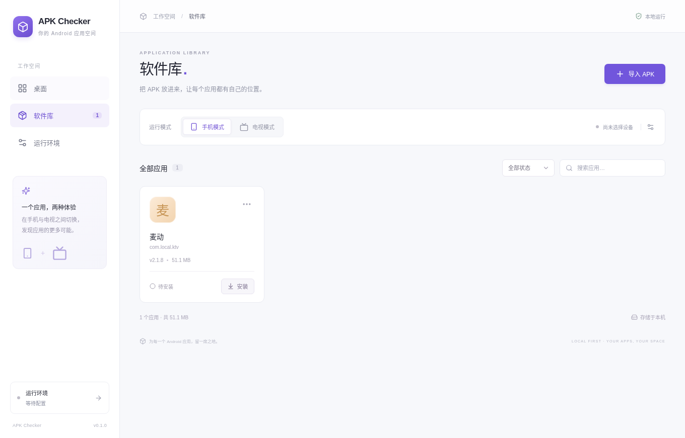

# 麦动 KTV 2.1.8 实际 APK 测试

测试日期：2026-11-05。使用用户指定的[官方 Release](https://gitee.com/yangyachao-X/maidong-ktv/releases/tag/2.1.8) 附件，未重新编译或修改 APK。

## 安装包

| 项目 | 实际解析结果 |
| --- | --- |
| 文件 | `Maidong-KTV-2.1.8.apk` |
| 大小 | 53,568,374 字节（约 51.1 MiB） |
| 包名 | `com.local.ktv` |
| 显示名称 | 麦动 |
| 版本 | `2.1.8` / versionCode `11` |
| Android 要求 | minSdk 21，targetSdk 25 |
| 原生库 | `arm64-v8a`、`armeabi-v7a`，没有 x86 / x86_64 库 |
| 启动入口 | 手机与电视均为 `com.local.ktv.MainActivity` |
| 屏幕方向 | Manifest 固定 landscape，手机模式也会横屏 |
| 签名 | Android Build-Tools 35 的 apksigner 验证 v1、v2 签名通过 |

SHA-256：

```text
86ef92ec8b1ac277eb68f28f3ff4fb421f7bc2a1e6093229a706d3aaa0310a3b
```

## 0.1.x 外部环境测试结果

本地使用真实 aapt 和 AppLibrary 验证了导入、同文件去重、软件库持久化；实际 Electron 窗口正确显示应用名称、版本、大小和待安装状态。没有设备时安装正确返回错误，未写入已安装记录。

下图为 0.1.0 阶段实际导入截图；0.1.1 的 macOS 打包验收截图另存于构建产物的 `mac-verification.png`。



[标准镜像测试记录](https://github.com/ecojust/apk-checker/actions/runs/42039273057) 使用 GitHub 的 Ubuntu 22.04 主机和真实 Android Emulator；没有模拟 adb 或安装成功结果。它验证 Android 运行流程，不代表 macOS / Windows 实机性能测试。

| 设备镜像 | 结果 |
| --- | --- |
| Android 11 / API 30，Google APIs，x86_64，Pixel 2 | 通过实际导入、安装、安装记录持久化、scrcpy 视频窗口启动、前台应用/进程检查、方向键输入后的存活检查和卸载。 |
| Android TV 12 / API 31，android-tv，x86，1080p | 安装失败，Android 返回 `INSTALL_FAILED_NO_MATCHING_ABIS`。该镜像不能加载 APK 的 ARM 原生库，未进入启动或播放测试。 |

电视失败是这款 APK 与所测镜像的 ABI 不匹配，不表示所有 Android TV 镜像都无法使用，也不能通过更换 Electron / Tauri 解决。

## 新版电视补测记录

API 36 / android-tv / x86_64 与 scrcpy 5.0.1 的结果分阶段保留：

- [42040304820](https://github.com/ecojust/apk-checker/actions/runs/42040304820)：原版 APK 安装成功，scrcpy 因 CI 没有声卡而失败，未完成视频窗口验收。
- [42041208224](https://github.com/ecojust/apk-checker/actions/runs/42041208224)：加入 CI 专用 SDL dummy 音频输出后，第一次尝试在安装的 180 秒时限处超时；后续尝试在工具准备阶段停滞并取消。
- [42043737275](https://github.com/ecojust/apk-checker/actions/runs/42043737275)：复用 hosted 工具后仍在 `adb install -r` 超时，未证明启动成功。

0.2.0 的[自动环境测试记录](managed-runtime.md)独立记录内置 APK 解析、私有工具／AVD 自动准备和新版实测结果。上述旧环境通过结论不能替代新流程验证。

## 测试边界

- 无人值守测试在安装后授予 APK 已声明的读写存储权限；没有授予麦克风权限。
- 方向键测试只验证按键注入后应用仍在前台并存活，未断言每个控件的焦点移动。
- 未测试歌曲播放、FFmpeg 解码负载、音画同步、录音、音频延迟、扫码点歌和 USB 设备。
- 运行截图、logcat、aapt 元数据和 JSON 结果保存在各 CI run 的 artifacts 中，保留 14 天；APK 本体不上传。
- 测试脚本要求使用没有安装 `com.local.ktv` 的干净 AVD，避免覆盖或删除已有用户数据。

## 重现旧版外部环境测试

本地需要已经启动的测试 AVD、Android SDK、aapt、scrcpy，以及下载好的原版 APK。设置 `APK_PATH`、`EXPECTED_APK_SHA256`、`ANDROID_HOME`、`APK_TEST_MODE`（phone / tv）、`APK_TEST_AVD`、`SCRCPY_PATH` 后运行：

```sh
npm run test:apk
```

脚本会实际安装并在测试结束时卸载该 APK。CI 的 [APK 测试工作流](../../.github/workflows/apk-smoke.yml) 也支持手动选择标准手机/电视组合或较新的 64 位电视镜像。

新版完整流程使用 `scripts/managed-apk-smoke.ts` 和 `.github/workflows/managed-apk-smoke.yml`，由程序自行下载环境、生成私有 AVD，无需手动安装 SDK 或准备 AVD。
