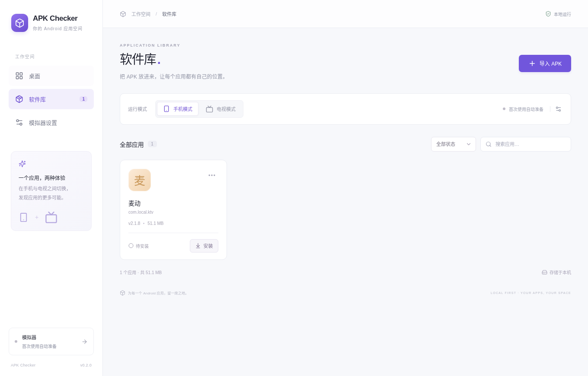

# 0.2.x 内置解析与自动运行环境验证

本记录对应 2026-11-05 的 0.2.0 自动环境实现。它区分源码功能、fixture 验证、真实归档检查和真实 Android 运行；新版本的提交及 CI 结果应继续追加，不能继承 0.1.1 的验收结论。

## 当前补丁状态

0.2.1 的完整手机／电视托管流程和三平台构建已通过，用户确认 ARM Mac 窗口可持续打开。0.2.2 改用原生窗口以显示原 APK 的安全登录表单，三平台构建通过，实际空表单验证仍在完善；证据与失败见[安全登录检查](secure-login.md)。电脑实体键盘输入问题单独记录于[文字输入检查](keyboard-input.md)，0.2.3 正在补充完整文字发送入口。下文较早的“待验收”是对应历史阶段状态，不覆盖后续追加结果。

## 分发与运行边界

| 部分 | 提供方式 | 用户需要做什么 |
| --- | --- | --- |
| APK Manifest／资源解析 | JavaScript 模块完全内置 | 直接导入完整 APK；无需联网或 aapt |
| Platform-Tools 37.0.1、scrcpy 5.0.1 | 构建时校验原始归档，随安装包资源提供 | 无需配置路径或另行安装 |
| Emulator 37.2.13、手机／电视镜像 | 首次准备从固定来源下载、校验并解包 | 阅读并勾选许可，保持联网并预留空间 |
| 手机／电视 AVD | 在应用数据目录自动创建，按模式和 ABI 隔离 | 在所需模式安装 APK |
| 硬件虚拟化 | 宿主 CPU、固件和操作系统提供 | Windows 等平台可能需要启用对应功能 |

Google 官方源失败时可使用腾讯 Android SDK 镜像，文件必须符合目录中同一固定大小与摘要。资源目录是 [runtime-catalog.json](../../resources/runtime-catalog.json)，版本 `2026-11-05.1`；SHA-1 或 SHA-256 算法按上游条目固定，不以文件名或 HTTP 成功代替校验。scrcpy 使用官方发行版。

首次准备不是离线安装。系统准备完成后可复用本地文件离线启动；APK 自身的网络服务不在此保证范围内。建议为每种模式至少预留 **25 GB** 可用空间，实际检查取决于下载、展开、临时目录和 Android 用户数据需求。

生产流程不需要 Android Studio、Java、SDK Manager、aapt / aapt2 或手动配置开发环境。内部保留 adb 用于指定模拟器，使用私有回环端口和 AVD 目录；不提供连接真机、设备部署或调试界面。私有端口不代表 adb 守护进程绝不枚举 USB；业务层过滤非模拟器 serial，并校验目标 AVD，不向这些设备发出应用操作。

## 资源与架构

以下为当前目录固定的压缩归档字节数，不是完整安装包或解压后的占用。

| 目标 | 随包通信＋显示归档 | 引擎首次下载 | 手机镜像首次下载 | 电视镜像首次下载 |
| --- | ---: | ---: | ---: | ---: |
| macOS ARM64 | 28,676,466 | 416,113,219 | 1,244,324,730 | 970,375,839 |
| macOS Intel | 29,588,672 | 488,733,162 | 1,438,186,618 | 990,109,855 |
| Windows x64 | 19,309,623 | 455,344,678 | 1,438,186,618 | 990,109,855 |

手机为 Android 11／API 30／Google APIs，电视为 Android TV 16／API 36。Apple Silicon 使用 `arm64-v8a`，Intel／Windows 使用 `x86_64`。资源条目存在和归档下载成功不证明目标主机能够启动，也不证明 ARM APK 在 x86_64 镜像中的转译兼容。

## 已执行验证

### 内置 APK 解析与软件库

- 命令：`npm test -- tests/apk-metadata.test.ts tests/library.test.ts`；该阶段 **34／34 通过**。后续迁移回归可能增加数量，以最终 CI 输出为准。
- 使用真实 ZIP fixture 验证 deflate、CRC、重复元数据、路径逃逸和解压大小上限；二进制 fixture 覆盖 UTF-8／UTF-16、中文标签、手机／电视入口、别名、禁用／非导出组件，以及 dense／sparse／offset16／compact 资源。
- 对字符串偏移复用、重叠展开、零长度块、越界及循环引用有防护；单次解析共享工作量与解码预算，避免重复资源解析放大。
- 原版 `Maidong-KTV-2.1.8.apk` 实际通过 `AppLibrary.importApk(sourcePath)` 导入，无 aapt 路径或外部解析进程；重复导入去重及新实例重载持久化通过。
- APK 53,568,374 字节，SHA-256 `86ef92ec8b1ac277eb68f28f3ff4fb421f7bc2a1e6093229a706d3aaa0310a3b`；结果为「麦动」、`com.local.ktv`、版本 `2.1.8`／`11`、minSdk 21，手机和电视入口均为 `com.local.ktv.MainActivity`。来源、签名及原生库说明见[既有 APK 报告](maidong-2.1.8.md)。
- 实际启动 0.2.0 构建后的 Electron 主进程和界面，在 `aaptFound=false`、`adbFound=false` 的独立配置下显示真实导入的麦动；许可 IPC 返回实际文本，未同意条款时准备被拒绝，注入外部 SDK／AVD 设置被忽略，路径选择 API 已移除，renderer 保持 Node 隔离。该检查没有启动模拟器。



### 环境准备、私有设备与界面

- `npx vitest run tests/managed-runtime.test.ts`：该阶段 **25／25 通过**。真实 ZIP／tar fixture 测试校验和解包、取消与退出清理、部分下载续传、镜像回退、许可证变更、崩溃恢复、数据保留及跨 ABI 设备隔离；网络响应使用测试替身，不代表真实 Google 镜像已完整下载。
- AndroidRuntime 定向测试该阶段 **49 项通过**，包含环境传递、非模拟器设备过滤、目标模式检查、私有 adb 服务归属与清理。命令替身不代表真实 adb 私有端口运行成功。
- Playwright fixture 验证首次许可默认未同意、准备后继续安装／打开、失败和取消不会继续、许可更新、1040×720 布局；无浏览器错误。这里未启动 Android。
- 主 agent 在该阶段执行 `npm test` 得到 **117 项通过**，`npm run build` 通过；此后仍有新增回归，最终全量结果待追加。`npm run check` 已通过。

### 真实 Linux 归档

- 在本次 Linux x64 环境实际执行 `npm run runtime:prepare`，获得 Platform-Tools 和 scrcpy，共 **26,937,929 字节**；`scripts/verify-runtime-resources.mjs` 按目录重新校验大小、摘要及许可证，通过。沙箱网络需要 `NODE_USE_ENV_PROXY=1`，这是本次环境的代理配置，不是产品安装前提。
- 使用真实 `ManagedRuntime.installComponent` 校验并解包两个归档，实际运行 `adb version` 返回 `37.0.1-15733141`，`scrcpy --version` 返回 `5.0.1`。
- 该检查只验证通信／显示组件，没有完成 Emulator、系统镜像下载、完整 `prepare`、新 AVD 启动或 APK 安装。
- 临时脚本与产物位于 `/workspace/scratch/runtime-catalog/`，后续环境可能不存在。可复用的校验入口现为 [verify-runtime-resources.mjs](../../scripts/verify-runtime-resources.mjs) 和 [verify-portable-tools.ts](../../scripts/verify-portable-tools.ts)，不依赖此临时目录交接。

## 汇总验证

- 全量 **130 项测试通过**（解析器 16、软件库与迁移 25、AndroidRuntime 50、管理器 28、目录 11）；TypeScript 检查和生产构建通过。
- 旧安装记录迁移在原子更新前备份索引，仅解除不同 AVD 的关联；旧 APK 缓存和外部设备数据保留，重复启动不会重复备份。
- 真实 adb 37.0.1 检查发现显式 `127.0.0.1` socket 被识别为远程服务，已修正为独立端口的 `localhost`。真实 Linux `AndroidRuntime.getStatus()` 自动启动内部服务，`dispose()` 后端口关闭；新的原生工具校验脚本会在三平台重复这个检查。
- TV 镜像实际展开约 8.14 GiB，不能按压缩大小的四倍估算。目录现保存所有组件准确 `unpackedSize`，磁盘预检计入下载缓存、完整 staging、6 GiB 数据分区、快照和余量；取消 tar 解包、退出等待及 crash staging 清理已覆盖。
- 三平台构建和新 managed APK 工作流待本次提交推送后的执行结果，尚未计为通过。

## 可复查步骤

基础逻辑与构建：

```sh
npm ci
npm run check
npm test
npm run build
npm run runtime:prepare
node scripts/verify-runtime-resources.mjs resources
npx tsx scripts/verify-portable-tools.ts resources
```

最后两步校验当前宿主资源，并在独立临时目录使用实际管理器解包、执行基础工具；不等于完整 Android 验收。安装包内资源还需在打包后重新校验，并在对应原生平台执行工具检查。

完整托管流程入口为 [managed-apk-smoke.ts](../../scripts/managed-apk-smoke.ts) 和 [managed-apk-smoke.yml](../../.github/workflows/managed-apk-smoke.yml)。脚本创建独立临时数据目录，使用指定原版 APK 的固定哈希，经过实际管理器下载／校验／解包和私有 AVD 创建，再自动启动、安装、打开 scrcpy、检查前台／进程、注入方向键并卸载；保留截图、logcat 和 JSON 摘要，退出时清理测试设备与临时数据。

在已满足硬件虚拟化和显示条件的 Linux 测试主机上，可按工作流下载原版 APK 后执行：

```sh
APK_PATH=/absolute/path/Maidong-KTV-2.1.8.apk APK_TEST_MODE=phone \
  xvfb-run -a npx tsx scripts/managed-apk-smoke.ts
# 用 APK_TEST_MODE=tv 单独验证电视模式。
```

这是会下载大文件、启动模拟器并实际安装／卸载的集成测试。脚本的测试许可接受不代替产品中用户阅读并勾选条款；不复用用户已有 AVD。无声卡 CI 的 dummy 音频输出不能作为播放、录音或音频延迟证据。

## 尚未通过的验收

- 新管理器在干净应用目录中完整准备手机／电视系统后实际启动及麦动安装运行：工作流已新增，尚无通过结果。
- 0.2.0 三平台安装包内资源、Mac 签名／原生启动、Windows 原生工具和界面启动：待新版 CI／目标主机结果。
- 用户 Mac 上下载隔离／Gatekeeper 行为、KTV 播放／录音／扫码点歌、遥控器实际焦点移动、端到端性能：未验证。

[0.1.1 macOS 签名及启动](macos-0.1.1.md)已单独通过，但没有 Developer ID／Apple 公证；不能计为 0.2.0 通过。旧 TV API 31 的 ABI 安装失败及 API 36 的 CI 声卡／安装超时记录继续保留，不用新 fixture 结果替换。

## 首轮 CI 反馈（保留失败）

源码 `e2f359b` 已推送。[原生构建 42049512559](https://github.com/ecojust/apk-checker/actions/runs/42049512559) 在单测阶段发现 Mac 临时目录别名导致安全链接误判，以及 Windows checkout 改变许可证换行字节；本轮未生成通过验收的 0.2.0 安装包。[托管 APK 42049503832](https://github.com/ecojust/apk-checker/actions/runs/42049503832) 在宿主 KVM／显示预检失败，未进入 Android 准备或安装。后续修复结果追加记录，不覆盖本轮失败。

## 0.2.0 原生验收与真实托管运行

源码 `01a217b` 的[构建 42050053204](https://github.com/ecojust/apk-checker/actions/runs/42050053204) 三平台全部通过。两种 Mac 均通过 DMG 严格签名、实际应用启动、IPC、资源 SHA 校验和真实基础工具执行；Windows 通过资源及基础工具执行。三平台均实际验证私有 adb 自动启动及退出清理，Windows 未额外声称 Electron 界面启动。

安装包：[ARM Mac](https://github.com/ecojust/apk-checker/actions/runs/42050053204/artifacts/13426895715)、[Intel Mac](https://github.com/ecojust/apk-checker/actions/runs/42050053204/artifacts/13427165677)、[Windows](https://github.com/ecojust/apk-checker/actions/runs/42050053204/artifacts/13425772954)。这是 0.2.0 构建，不代表下面发现的显示／关停问题已经修复；更新补丁另行标明。

[托管流程 42050039215](https://github.com/ecojust/apk-checker/actions/runs/42050039215) 两组完成程序自身下载、校验、展开及自动创建／启动 AVD。手机组真实安装并发出成功启动，随后等待显示窗口视频日志超时；电视组在安装时失去有效设备，原诊断只保留 stderr 前缀，未取得明确兼容性错误，不能断言 ABI 不匹配。两组清理又在 QEMU 保存快照时删除临时目录，出现 ENOTEMPTY；本轮整体失败。

0.2.1 修复及补测范围：

- 官方 scrcpy 5.0.1 在 Unix 管道中缓冲 INFO 输出，硬件解码还会输出 `Texture (VideoToolbox/D3D11VA/VA-API)`；原等待逻辑会误判。Mac 使用系统 BSD `script` 提供 PTY，Linux 用 coreutils `stdbuf`，Windows 保持原生取消缓冲行为；扩展合法视频日志匹配，仍不把仅启动进程当作视频成功。
- 启动自有模拟器应用前唤醒并尝试解除普通锁屏，以符合 Android 11 音频捕获条件；没有全局关闭生产音频，CI dummy 音频仍不代表媒体播放验收。
- Emulator 收到停止命令后等待进程真正退出，超时只终止自身进程／进程树；无法确认退出时测试保留数据，不删除活动 AVD。安装错误保留 stdout、stderr、退出码，意外模拟器退出附诊断。
- 本地真实 Linux scrcpy 测试已确认活跃进程能实时输出日志；Mac PTY 实际子进程清理加入原生构建验证。完整显示和电视安装结果待下一轮真实托管 CI。

## 0.2.1 真实手机与电视链路结果（保留整体清理失败）

源码 `7ef7293` 的[托管流程 42052813767](https://github.com/ecojust/apk-checker/actions/runs/42052813767) 使用相同原版麦动 APK，在两个独立 Linux CI 主机中从全新应用目录执行。此次没有 SDK Manager、外部 SDK 路径或预建 AVD；基础工具来自随包归档，Emulator／镜像由实际 `ManagedRuntime.prepare()` 下载、校验、展开并创建私有设备。

| 实际检查 | 手机 API 30 | 电视 API 36 |
| --- | --- | --- |
| 固定 APK 校验、内置解析、重复导入 | 通过 | 通过 |
| 首次许可记录、运行环境准备和私有 AVD 创建 | 通过 | 通过 |
| 自动启动私有 AVD、真实安装、持久化桌面标记 | 通过 | 通过 |
| scrcpy 收到实际视频、APK 进程和前台入口检查 | 通过 | 通过 |
| 方向键注入后进程存活、前台仍属于麦动 | 通过 | 通过 |
| 卸载 APK、清除桌面标记 | 通过 | 通过 |
| 最终所有私有进程立即为空的断言 | 失败，仅剩下述 vendor watchdog | 失败，仅剩下述 vendor watchdog |

设备实际报告：

- 手机：`APKChecker_Phone_30_x86_64`，Android 11，ABI 为 `x86_64,x86,arm64-v8a,armeabi-v7a,armeabi`。
- 电视：`APKChecker_TV_36_x86_64`，Android 16，ABI 为 `x86_64,arm64-v8a`；指纹以 `google/sdk_google_atv64_x86_64/emu64xa:16/BT2A.260319.001/15058170` 开头。
- 两组均报告 `ro.dalvik.vm.native.bridge=libndk_translation.so`。这证明本次所选 x86_64 镜像确实安装并运行了该 ARM APK；不改变旧 TV API 31/x86 的 `INSTALL_FAILED_NO_MATCHING_ABIS` 结论，也不代表所有镜像或目标主机都兼容。

此次 QEMU、netsimd、crashpad、scrcpy 和私有 adb 均已退出。清理断言捕捉到 Android Emulator 正常关停时启动的短暂辅助进程：`emulator -kill <已退出 QEMU 的 PID> -sleep 20`。测试因此保留私有数据并以失败结束，**整轮工作流仍为失败，不能标为全部通过**；通过的运行步骤来自 CI 最终 `Managed phone/tv test stages` annotation 中逐项记录的实际执行结果。

测试修正仅允许这一精确参数形式的 watchdog 最多 25 秒自然结束，其他残留进程仍立即失败；等待后仍要求所有私有进程严格为空，再删除测试数据。报告记录即时进程列表、watchdog 等待时间和最终进程列表；关停不确认时继续保留数据。该修正不改产品关停实现，也不放宽安装、视频或前台检查，后续工作流结果需另行追加。

本次只验证 Linux CI 下的应用后端和 Android 视频窗口链路；未验证 Mac／Windows 上实际 APK 运行、每个方向键对应的焦点移动、歌曲播放、录音或音频延迟。CI dummy 音频设备不作为真实音频能力的证据。

## 0.2.1 最终托管流程验收通过

源码 `6f2e2b3` 的[最终托管流程 42054618011](https://github.com/ecojust/apk-checker/actions/runs/42054618011) 已完成，**手机和电视两个 job 均为 success**，两份实际测试摘要均为 `status: passed`。本次重新创建独立应用目录，重新经过原版 APK SHA-256 校验、内置解析、运行环境下载／校验／解包、私有 AVD 创建和实际自动启动，没有复用上一轮已安装应用或模拟成功结果。

两组均通过以下完整流程：

1. 导入原版麦动 2.1.8，验证重复导入及元数据。
2. 记录测试许可接受，通过真实管理器准备所选镜像及私有设备。
3. 自动启动 AVD、实际安装 APK，并验证桌面安装标记持久化。
4. 通过随包 scrcpy 收到实际视频，检查麦动进程存活和前台入口。
5. 注入四个方向键，再次检查前台／进程并生成截图。
6. 实际卸载 APK，确认包和桌面标记已移除。
7. 关闭测试设备及显示进程；精确 watchdog 自然结束后，最终私有进程列表严格为空，再清理临时数据。

手机仍为 API 30、`APKChecker_Phone_30_x86_64`，实际 ABI 为 `x86_64,x86,arm64-v8a,armeabi-v7a,armeabi`；电视仍为 API 36、`APKChecker_TV_36_x86_64`，实际 ABI 为 `x86_64,arm64-v8a`。两组均报告 `libndk_translation.so`。关停后的 watchdog 等待实际分别为手机 **511 ms**、电视 **1,029 ms**，最终 `privateProcessesAfterShutdown` 均为 `[]`，没有因关停失败保留私有数据。这些等待值只是本次 CI 清理证据，不是产品性能承诺。

可下载的截图、logcat、APK 元数据、AVD 配置、宿主诊断和 `summary.json`：

- [手机测试报告](https://github.com/ecojust/apk-checker/actions/runs/42054618011/artifacts/13429210902)
- [电视测试报告](https://github.com/ecojust/apk-checker/actions/runs/42054618011/artifacts/13428541861)

两份 artifact 保留 14 天；对应 job 的 `Managed phone/tv test stages` annotation 同时保留精简步骤及设备／关停证据。归档不包含 APK 或 Android 系统镜像。本轮成功不覆盖前面各轮失败记录，也不扩展为 Mac／Windows 上实际 APK 验收、人工检查所有界面、焦点移动正确性、媒体播放、录音或音频延迟已经通过。

## 0.2.3 原生安装包验收

生产源码 `4e11d39` 的[run 42068331626 / attempt 2](https://github.com/ecojust/apk-checker/actions/runs/42068331626) 三平台全部 success。ARM Mac／Intel Mac 各 216 项测试通过；Windows 214 项通过、2 项按平台跳过。三平台便携工具、私有 ADB 启停通过；两种 Mac 通过 DMG、严格签名、复制后签名、实际应用启动、renderer／IPC／托管首次使用检查，启动后包内容未变。

[ARM Mac](https://github.com/ecojust/apk-checker/actions/runs/42068331626/artifacts/13436507367) · [Intel Mac](https://github.com/ecojust/apk-checker/actions/runs/42068331626/artifacts/13434049459) · [Windows x64](https://github.com/ecojust/apk-checker/actions/runs/42068331626/artifacts/13433619176)。均为正式原生构建产物，未使用交叉构建备用包；仍不等同于 Apple 公证。Android 输入／登录的实际结果见专项记录。

第一次 attempt 的 ARM job 没有执行任何步骤，GitHub 报 `The job was not acquired by Runner of type hosted even after multiple attempts` 及容量限制；只重跑 ARM，保留此前 Intel／Windows 成功结果。官方 Actions 服务事件同期从 investigating 转为 monitoring。该基础设施失败继续保留，不能写成客户端代码失败。
