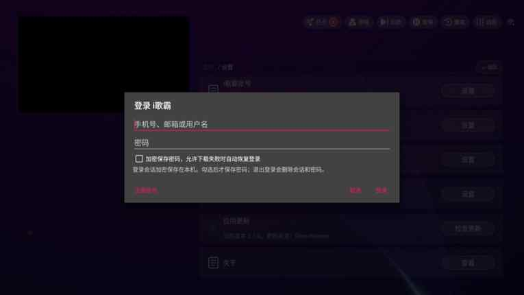
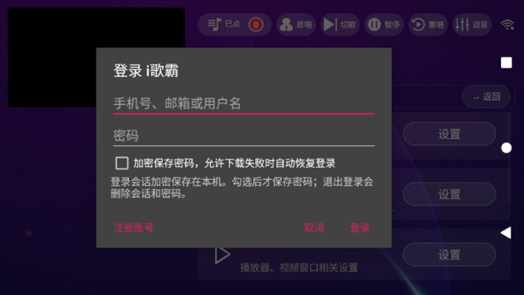

# i歌霸安全登录弹窗与原生模拟器窗口

用户在 0.2.1 ARM Mac 上确认麦动窗口已持续打开，但「i歌霸账号」登录弹窗黑屏。本次处理不输入账号密码、不提交登录，也不修改原版 APK。

## 已确认原因

原版麦动 2.1.8 的 `IgebaAccountDialog.kt:64-65` 在原生 AlertDialog 显示时调用 `Window.addFlags(WindowManager.LayoutParams.FLAG_SECURE)`。同一官方 APK 的 SHA-256 仍为 `86ef92ec8b1ac277eb68f28f3ff4fb421f7bc2a1e6093229a706d3aaa0310a3b`；其 `classes.dex` 中混淆方法 `Lh1/q;.onShow` 在 `0x15a3a4` 加载 `8192 / 0x2000`，随后在 `0x15a3a8` 调用 `Window.addFlags(I)`，与源码一致。

[Android 对 FLAG_SECURE 的定义](https://developer.android.com/reference/android/view/WindowManager.LayoutParams#FLAG_SECURE)会阻止该窗口出现在截图或非安全显示中。0.2.1 使用无窗口模拟器和 scrcpy 投屏，因此登录表单被遮黑。它是本地 `AlertDialog + EditText`，不是 WebView；打开表单时还未提交网络登录请求，不能把这个现象归因于密码、服务器或网页加载。

## 0.2.2 显示方式

生产管理环境使用模拟器自己的原生设备窗口。安装仍可在后台完成；第一次打开时保存并停止本程序启动的后台实例，再使用同一 AVD 和数据启动原生窗口。已运行的原生窗口复用，关闭后再打开会重新启动模拟器。已有 APK、安装记录和数据保留。

`-no-window` 会选择独立的 headless 程序，无法恢复 Qt 窗口，所以切换时必须重启自身模拟器。实现会等待进程真正退出，并检查 `adb emu avd windowtype` 返回 `windowtype=qtwindow`。不擅自关闭外部模拟器，不清除 `FLAG_SECURE`，不重新签名或改包，也不关闭 GPU。

首次切换需要等待模拟器保存和重新启动，界面会显示进度。已有原生窗口被最小化时，可能需要从系统 Dock／任务栏恢复；当前没有添加跨平台窗口置顶的系统权限要求。旧投屏代码保留作兼容诊断，生产自动准备的环境始终使用原生窗口。

## 验证方式与当前边界

- 自动测试实际执行「后台安装 → 保存／关停 → 同 AVD 原生打开」，核验设备、安装记录、进程退出和原生窗口类型。
- 可选登录检查只通过稳定控件打开「设置 → i歌霸账号」，验证原生用户名／密码输入框和原始安全窗口标记，不输入或提交任何凭据。
- 同时采集 Android 内部截图和独立 CI 宿主显示：前者输入区应保持安全遮黑，原生宿主窗口的对应区域应可见。截图只含全新设备的空表单；预览用于人工核验控件内容。
- 按 Back 关闭表单并确认正常页面恢复，再卸载测试 APK 和清理全部私有进程。

源码／原版 DEX 已确认根因；下方记录原生显示回归、实际安全弹窗截图和各版本安装包验收，保留失败及后续更正。此前 0.2.1 完整链路见[运行环境报告](managed-runtime.md)，不能替代本次安全弹窗验证。

## 已执行的 0.2.2 验证及保留失败

- `223d85a` 的[三平台安装包构建 42061147332](https://github.com/ecojust/apk-checker/actions/runs/42061147332) 全部通过，Mac 两种架构的 DMG、签名、应用启动和工具检查通过；全量 164 项本地测试通过。
- [首次原生 APK run 42061147067](https://github.com/ecojust/apk-checker/actions/runs/42061147067)：手机原生 QEMU 因 Linux CI 缺 `libpulse.so.0` 退出 127；TV 在原有 180 秒安装时限失败。均未进入安全表单验证。
- 补齐 CI `libpulse0` 后，`2ee9c03` 的[run 42065213408](https://github.com/ecojust/apk-checker/actions/runs/42065213408) 手机和电视都通过安装、原生窗口启动、宿主截图、前台检查、卸载及全部私有进程退出；TV 本轮安装约 60 秒，没有扩大时限。
- 本轮整体仍失败：手机已确认原生登录 EditText 和 `FLAG_SECURE`，随后 guest `screencap` 未返回 PNG，原检查尚未发布宿主表单预览；TV 首页 UI 树中未找到指定设置控件。正在保留具体截图诊断、先采集独立宿主表单并增加有界 UI 诊断，不能把这轮写成安全表单全通过。

- `4e11d39` 的[run 42068324515](https://github.com/ecojust/apk-checker/actions/runs/42068324515) 继续保留失败：TV 的 Android 旧 targetSdk 提示挡住首页；手机已取得原生空表单／EditText／FLAG_SECURE／宿主截图，但原生手机窗口仍竖屏（411×731），guest 横屏，无法直接按像素比例映射。guest 截图无 stdout／stderr，未解释为已证实的安全拒绝。后续将使用官方原生旋转操作后重新核对显示尺寸。
- GitHub 将单条预览 annotation 截为 4096 字符，导致 JPEG 的 base64 不完整，原图无法从本轮注解重建。后续预览按有界分片发布并校验重组，不把截断预览当作人工截图验收。

## 电视安全登录表单实际可见

生产源码仍为 `4e11d39`，验收脚本为 `1a01e14`。[run 42073174082](https://github.com/ecojust/apk-checker/actions/runs/42073174082) 的 TV 登录检查通过：原版 APK 的 `FLAG_SECURE` 仍存在，两原生 EditText 被确认；Android guest 截图对应两输入区黑像素比例均为 1，独立原生宿主图均为 0。分片重组得到完整 7,263 字节 JPEG，核对字节数并由两个 agent 实际查看，两个空输入框正向显示，登录按钮可见；关闭弹窗、卸载及全部私有进程退出通过。没有输入账号或提交登录。

同轮手机也观察到空输入框可见及原安全标志，但测试旋转选成反向横屏，图片整体倒置，未声称朝向正确。手机 guest 安全截图仍未返回像素，具体拒绝原因未验证，不能将其计为遮黑断言通过。后续测试将比较未受保护的 settings guest／host 基准图方向，避免单凭宽高比认定对齐。

本轮整体仍因输入探针的引号文本解析问题而失败；上述是明确独立的登录步骤结果，不是工作流全绿声明。电视模式的黑屏修复已由真实原版 APK 的原生窗口证据确认；目标 Mac 的使用效果仍需该主机验证。

## 手机正向原生表单通过

`3c2c5a8` / [run 42075870248](https://github.com/ecojust/apk-checker/actions/runs/42075870248) 手机登录步骤通过。未受保护 settings 基准图的 1,296 个采样点先确认 180° 更匹配，再经两次原生旋转校正；最终正常方向平均 RGB 差为 3.79，倒置方向为 40.35。完整预览已重组并人工查看，空用户名／密码框正向可见，原 FLAG_SECURE 保留；关闭弹窗和私有进程清理通过。

此轮 TV 的方向检查拒绝继续，宿主预览显示的是额外 Ctrl 键探针留下的 Emulator 多点触控覆盖层，guest 仍在 APK 设置页；该失败保留，不能推翻前一轮原版 TV 登录框的直接可见证据，也不将本轮 TV 登录标为通过。

## 最终独立复验

`1ba0ee6` 的 [run 42078663666 / TV job](https://github.com/ecojust/apk-checker/actions/runs/42078663666/job/127425631833) 全部通过，原版安全登录框正向可见，原 `FLAG_SECURE` 保留，guest 输入区遮黑而原生宿主输入区可见；最终预览与本页保存的电视截图一致。

`f9f4a7a` 的 [phone run 42080806076](https://github.com/ecojust/apk-checker/actions/runs/42080806076) 登录步骤再次通过：两原生 EditText、原安全标志、正向宿主表单和正常退出均确认；完整 7,749 字节预览已重组并人工查看。方向基准正常差 3.79、倒置差 40.35；guest 截图仍为空输出，明确不计作已证明安全遮黑。该 run 因独立的额外 XTest Ctrl+V 检查失败而总体失败，不影响上述步骤的独立结果，也不能称整体全通过。

两种模式均卸载干净测试 APK 并确认私有进程清空。全程没有输入凭据或提交登录，未修改 APK 或安全标志。这些是 Linux 原生 Android 窗口的实际证据；新版本在用户 Mac 上的实际显示仍需该主机确认。
